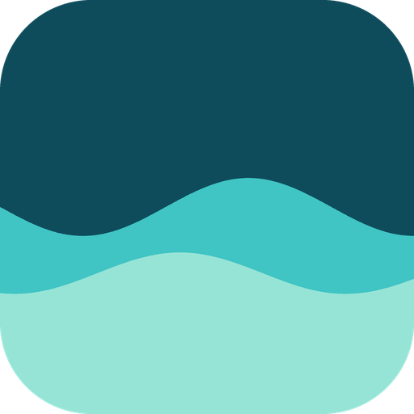
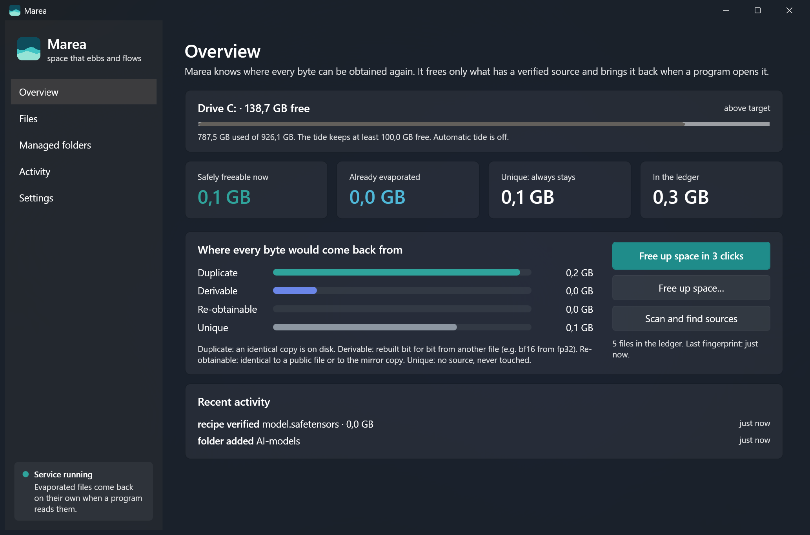
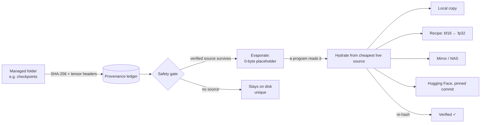
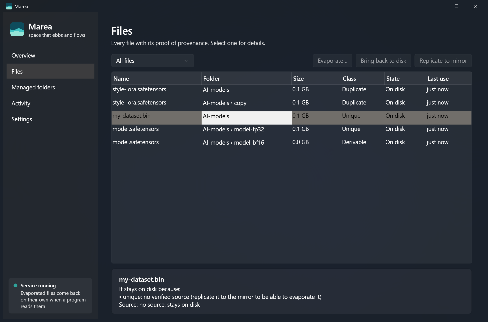
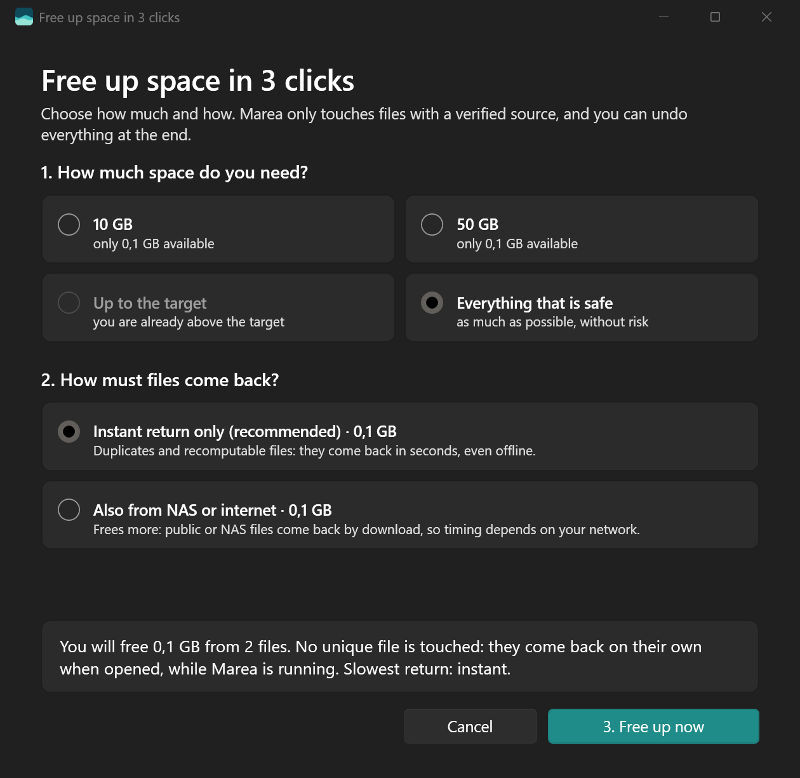

<p align="center"></p>

<h1 align="center">Marea</h1>

<p align="center"><b>Your AI models eat your disk. Marea gives the space back — without deleting a byte.</b></p>

<p align="center">
  <b>English</b> ·
  <a href="docs/i18n/README.it.md">Italiano</a> ·
  <a href="docs/i18n/README.es.md">Español</a> ·
  <a href="docs/i18n/README.fr.md">Français</a> ·
  <a href="docs/i18n/README.de.md">Deutsch</a>
</p>

<p align="center">
  <a href="https://github.com/indecenti/marea/actions/workflows/ci.yml"></a>
  <a href="https://github.com/indecenti/marea/actions/workflows/codeql.yml"></a>
  <a href="https://github.com/indecenti/marea/releases"></a>
  <a href="LICENSE"></a>
  
</p>

---

Local AI is heavy. Hugging Face checkpoints, ComfyUI models, LoRAs, GGUF files, the same
model in fp32 **and** bf16, the same 3 GB text encoder copied into four different apps…
A 1 TB drive fills up in weeks.

On one real workstation, Marea scanned **125 GB of models** and found **71 GB that could
leave the disk with zero risk**:

- 18 GB of byte-identical duplicates;
- 44 GB identical to public files on Hugging Face;
- 9 GB of bf16 weights that can be recomputed **bit for bit** from their fp32 originals.

Marea doesn't delete any of it. It **evaporates** it. Each file stays in its folder, with
its name and size, but takes **0 bytes** on disk. When any program opens it, ComfyUI or
Python or anything else, Marea brings it back on the fly and **verifies its SHA-256**.
Your apps never notice.

<p align="center"></p>

> 📖 **New here?** Read the [user manual](docs/MANUAL.md). **Testing it for us?** Follow the
> [tester guide](docs/TESTING.md): 15 minutes, safe, every step undoable.

## Table of contents

- [What's new about it](#whats-new-about-it)
- [How it works](#how-it-works)
- [Safety model](#safety-model)
- [Install](#install)
- [Quick start](#quick-start)
- [Command line](#command-line)
- [FAQ](#faq)
- [Roadmap](#roadmap)
- [Documentation](#documentation)
- [Build from source](#build-from-source)
- [Contributing](#contributing) · [License](#license)

## What's new about it

Disk cleaners guess from folder names and ask you *"delete this?"*. Dedup tools only see
byte-identical files. Marea **proves where every byte can be obtained again**, and frees
only what it can bring back. As far as we know, no other tool combines these:

| | Disk cleaners | Dedup / hard-link tools | **Marea** |
|---|---|---|---|
| Knows where a file can be re-obtained | ✗ (folder-name heuristics) | ✗ | **✓ cryptographic proof (SHA-256)** |
| Frees space without deleting | ✗ (delete or recycle bin) | partly (identical files only) | **✓ 0-byte placeholders** |
| Brings files back automatically on open | ✗ | n/a | **✓ transparent, verified** |
| Recognises fp32 ↔ bf16 copies of the same model | ✗ | ✗ | **✓ bit-exact recipe** |
| Matches files against public hubs | ✗ | ✗ | **✓ Hugging Face, pinned to a commit** |
| Decides *what* to free by cost of return × recency | ✗ | ✗ | **✓ "the tide"** |

Research on model storage (tensor-level dedup, fine-tune deltas, precision pairs) has so far
targeted the data centres of model hubs. Marea brings the idea to **your own disk**, and adds
the one missing piece: a reversible way to free the space.

## How it works



Every file gets a **recoverability class**:

| Class | Proof | Comes back from | Typical time |
|---|---|---|---|
| **Duplicate** | same SHA-256 as another file on disk | that local copy | seconds |
| **Derivable** | rebuilt from other local files (e.g. bf16 from fp32, round-to-nearest-even), proven by hashing the full rebuild | a recomputation | seconds to a minute |
| **Re-obtainable** | same SHA-256 as a public Hugging Face file pinned to a commit, an Ollama registry blob (by digest), or a verified copy on your mirror/NAS | download / LAN | depends on your connection |
| **Unique** | no known source | **never evaporated**. Replicate it to your mirror first and it becomes re-obtainable | — |

**The tide** keeps a target of free space (100 GB by default). It ranks candidates by
*expected cost* = probability you'll need the file soon × seconds to bring it back ÷ GB
freed. A duplicate you haven't touched in a month goes first; a model you used yesterday
stays. Automatic mode is **off by default**: you can also free space by hand from a plan
you review.

**Sources are found automatically.** Marea reads evidence already on your disk: the Hugging Face
cache, `base_model` in model cards, `_name_or_path` in configs, git remotes and Ollama models
pulled from `hf.co`. It then checks those authors' related repositories. On the test workstation
this alone proved 65% of the re-obtainable bytes with no configuration. The optional *search by
folder name* (off by default, because it sends folder names) found the rest in 5 seconds.

Under the hood Marea uses the **Windows Cloud Files API**, the same mechanism as OneDrive
"online-only" files. Each file's own provenance plays the part of the cloud. No admin rights,
no kernel driver of its own, no background service.

<p align="center"></p>

## Safety model

Marea moves people's files, so the rule is **never lose a byte**:

1. **Nothing leaves without an independent, verified way back** that will still exist
   afterwards. Two copies never leave together, and the sources of a recipe are pinned.
2. **Last-moment proof.** Before evaporating, Marea opens the file exclusively, re-hashes
   every byte, checks the source answers *now*, and refuses hard-linked files.
3. **Every byte that comes back is re-verified.** A mismatch is logged and the file is
   fetched again from scratch.
4. **Folders are never detached while placeholders remain.** Windows would delete them.
   A test covers the case where the ledger itself loses track of a file.
5. **You stay in control.** The first scan only measures, and every change goes through a
   plan you confirm. "Bring everything back" is one click, and the uninstaller runs it
   **before** removing anything.
6. **Minimal network surface.** Outbound HTTPS to Hugging Face only. Hosts are allow-listed
   on every redirect, and only public repository names are sent. No telemetry.

Full threat model: [SECURITY.md](SECURITY.md).

## Field test

On a real workstation (ACE-Step and Side-Step checkpoints, Windows 11, NVMe):

| Step | Result |
|---|---|
| Scan + fingerprint 63.7 GB of models | 65 s |
| Safely freeable (instant return only) | 19.9 GB: 5 duplicates and 1 bf16 model recomputable from fp32 |
| Evaporate those 19.9 GB (with last-moment bit-by-bit re-hash) | 11 s |
| Open the evaporated bf16 model with `safetensors` + PyTorch | data rebuilt from fp32 in 35 s, **SHA-256 identical** |
| Open an evaporated 4.5 GB duplicate | back in ~5 s, **SHA-256 identical** |
| Undo the cleanup | every file ordinary again, folders detached |

## Install

> **Pre-release.** Builds are not code-signed yet, so Windows SmartScreen may warn on first run
> (*More info → Run anyway*). Verify the download with the `.sha256` file next to it.

1. Download `Marea-<version>-win-x64-portable.zip` from [Releases](https://github.com/indecenti/marea/releases).
2. Unzip it anywhere and run **`Marea.exe`**. .NET is included; nothing else to install.
   Releases are built by GitHub Actions; check that yours came from this repository's CI with
   `gh attestation verify Marea-<version>-win-x64-portable.zip --repo indecenti/marea`.
3. Before deleting the folder, open *Settings → Bring everything back and detach*.

A per-user MSI installer (no admin) is ready in [`installer/`](installer) and will ship
with the first signed release.

**Requirements:** Windows 10 1809+ or Windows 11, x64, NTFS.

## Quick start

1. **First run**: a short guide explains what Marea does and never does, then finds your
   model folders automatically (`checkpoints`, `models`, `hub`, …). Untick any you don't want
   managed.
2. **Scan**: Marea fingerprints the files and looks for sources. This step only measures.
3. **Free up space in 3 clicks**: choose *how much* (10 GB, 50 GB, up to your target, or
   everything that is safe) and *how files must come back* (instant only, meaning duplicates and
   recipes that return offline in seconds, or also from your NAS / the internet), then press
   **Free up now**. A single **Undo this cleanup** button brings back exactly that batch. Power
   users can open the detailed plan instead and pick files one by one.

   <p align="center"></p>

4. **Forget about it**: when a program opens an evaporated file, it comes back by itself.
   Keep Marea running (it offers to start with Windows).

## Command line

`mareactl` uses the same engine as the app, so it works in scripts and over SSH.

```
mareactl status                     disk and ledger status
mareactl add <folder>               manage a folder (e.g. ...\checkpoints)
mareactl remove <folder>            bring everything back and stop managing it
mareactl scan                       fingerprints, sources, classes
mareactl plan [--gb N]              what the tide would evaporate (touches nothing)
mareactl evaporate [--gb N] --yes   evaporate according to the plan
mareactl free [--gb N|--all] [--instant] --yes   quick cleanup, undoable
mareactl undo                       undo the last cleanup
mareactl restore <file>             bring one file back now
mareactl replicate                  copy unique files to the mirror (NAS)
mareactl restore-all --yes          emergency exit: bring everything back, detach everything
mareactl journal [n]                recent activity
mareactl agent                      serve evaporated files without the app open
```

Environment: `MAREA_DATA` (data folder), `MAREA_LANG` (`en`, `it`, `es`, `fr`, `de`).

## FAQ

**What happens if Marea isn't running when a program opens an evaporated file?**
The program gets a "cloud provider not running" error, exactly like OneDrive files when
OneDrive is closed. Start Marea and it works again. That's why Marea offers to start with
Windows.

**Can I lose a file?**
Marea is designed so that you can't. It only evaporates files with a verified source that
survives the operation, re-verifies on return, and never detaches a folder holding
placeholders. Unique files are never touched. See [SECURITY.md](SECURITY.md) and the tests
in [`tests/`](tests).

**Does it need internet?**
Only for files whose source is Hugging Face. Duplicates, recipes and NAS copies come back
offline.

**What does it send over the network?**
Names of the public repositories in your settings, and requests for public files. Never
your paths, file names or hashes. No telemetry.

**Does it slow down my apps?**
Only the first open of an evaporated file waits for the data (seconds for a local copy).
Files you used recently are never evaporated.

**What about Ollama, LM Studio, pip caches?**
Ollama is supported: add `.ollama\models\blobs` (the first-run guide proposes it) and its blobs
come back from the Ollama registry, verified by digest. If you don't use Ollama, nothing changes.
Package caches are better cleaned by their own tools.

**macOS / Linux?**
The engine is portable .NET. Only the placeholder layer is Windows-specific: macOS has File
Provider, Linux has fanotify pre-content events or FUSE. Contributions welcome.

**How do I uninstall?**
Use the uninstaller (MSI), or *Settings → Bring everything back and detach* and then delete
the folder (portable). Either way every file comes back first.

## Roadmap

- [x] Provenance ledger, duplicates, Hugging Face sources, NAS mirror, bf16 ← fp32 recipes
- [x] Transparent evaporation and verified return (Windows Cloud Files)
- [x] Tide planner, desktop app, `mareactl`, 5 languages, portable build
- [x] "Free up space in 3 clicks" wizard with instant-only mode and one-click undo
- [x] Automatic source discovery, Ollama source, update notifications, attested CI releases
- [ ] Signed releases, MSI installer, winget
- [ ] Civitai source (by hash)
- [ ] Predictive high tide: bring models back *before* you need them
- [ ] Tensor-level store: share layers across fine-tunes and merges
- [ ] File Explorer navigation-pane entry
- [ ] macOS and Linux backends

## Documentation

| Document | For |
|---|---|
| [User manual](docs/MANUAL.md) | Everyone: install, first run, freeing space, undo, settings, troubleshooting |
| [Tester guide](docs/TESTING.md) | Early testers: a safe 15-minute checklist and what to report |
| [Security model](SECURITY.md) | How Marea guarantees it never loses a byte |
| [Architecture](docs/ARCHITECTURE.md) | Contributors: how the engine works |
| [Distribution](docs/DISTRIBUTION.md) | Maintainers: releases, signing, installer, winget |
| [Changelog](CHANGELOG.md) | What changed in each version |

## Build from source

```
git clone https://github.com/indecenti/marea
cd marea
dotnet test tests/Marea.Tests --filter "Category!=Network"
powershell -File build/publish.ps1        # portable build in dist/
```

Requires the .NET 10 SDK. The architecture is described in
[docs/ARCHITECTURE.md](docs/ARCHITECTURE.md), and releases in
[docs/DISTRIBUTION.md](docs/DISTRIBUTION.md).

## Contributing

Issues and pull requests are welcome: new sources, translations, macOS/Linux backends. Please
read [CONTRIBUTING.md](CONTRIBUTING.md) first; the bar is *never lose a byte*. Report security
issues privately (see [SECURITY.md](SECURITY.md)).

## License

[MIT](LICENSE) © Marea contributors
