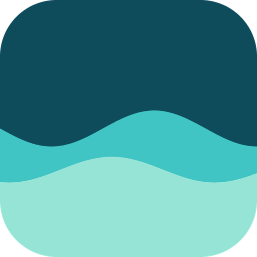
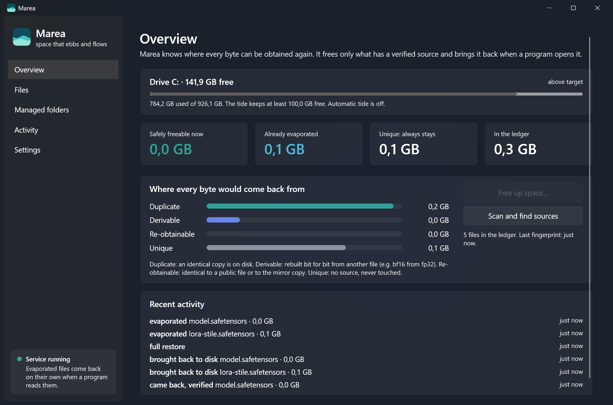

<h1 align="center">Marea</h1>

<b>Deine KI-Modelle fressen deine Festplatte. Marea gibt dir den Speicher zurück, ohne ein einziges Byte zu löschen.</b>

  <a href="../../README.md">English</a> ·
  <a href="README.it.md">Italiano</a> ·
  <a href="README.es.md">Español</a> ·
  <a href="README.fr.md">Français</a> ·
  <b>Deutsch</b>

---

Lokale KI ist schwer. Hugging-Face-Checkpoints, ComfyUI-Modelle, LoRAs, GGUF-Dateien, dasselbe
Modell in fp32 **und** bf16, derselbe 3-GB-Text-Encoder in vier verschiedenen Apps… Eine 1-TB-Platte
ist in wenigen Wochen voll.

Auf einer echten Workstation hat Marea **125 GB Modelle** untersucht und **71 GB gefunden, die
ohne jedes Risiko die Platte verlassen konnten**:

- 18 GB byte-identische Duplikate;
- 44 GB, die identisch mit öffentlichen Dateien auf Hugging Face sind;
- 9 GB bf16-Gewichte, die sich **Bit für Bit** aus ihren fp32-Originalen berechnen lassen.

Marea löscht nichts davon, sondern lässt es **verdunsten**. Jede Datei bleibt mit Namen und
Größe in ihrem Ordner, belegt aber **0 Byte**. Öffnet ein Programm sie, holt Marea sie sofort
zurück und **prüft ihren SHA-256**. Deine Apps merken nichts.

## Was daran neu ist

Aufräum-Tools raten anhand von Ordnernamen und fragen *„Löschen?“*. Deduplizierer sehen nur
byte-identische Dateien. Marea **beweist, woher sich jedes Byte wieder beschaffen lässt**, und
gibt nur frei, was es zurückholen kann.

| | Aufräum-Tools | Deduplizierer / Hardlinks | **Marea** |
|---|---|---|---|
| Weiß, woher eine Datei wiederkommt | ✗ | ✗ | **✓ kryptografischer Nachweis (SHA-256)** |
| Gibt Speicher frei, ohne zu löschen | ✗ | teilweise | **✓ 0-Byte-Platzhalter** |
| Holt Dateien beim Öffnen von selbst zurück | ✗ | — | **✓ transparent und geprüft** |
| Erkennt fp32 ↔ bf16-Kopien desselben Modells | ✗ | ✗ | **✓ bitgenaues Rezept** |
| Gleicht mit öffentlichen Hubs ab | ✗ | ✗ | **✓ Hugging Face, auf einen Commit fixiert** |
| Wählt nach Rückkehrkosten × letzter Nutzung aus | ✗ | ✗ | **✓ „die Flut“** |

## So funktioniert es

| Klasse | Nachweis | Kommt zurück von |
|---|---|---|
| **Duplikat** | gleicher SHA-256 wie eine andere Datei auf der Platte | dieser lokalen Kopie, in Sekunden |
| **Ableitbar** | wird aus anderen lokalen Dateien neu gebaut (z. B. bf16 aus fp32), bewiesen durch den Fingerabdruck des vollständigen Neuaufbaus | einer Neuberechnung |
| **Wiederbeschaffbar** | gleicher SHA-256 wie eine öffentliche, auf einen Commit fixierte Hugging-Face-Datei oder eine geprüfte Kopie auf dem NAS | Download / LAN |
| **Einzigartig** | keine bekannte Quelle | **verdunstet nie**: zuerst auf das NAS replizieren |

**Die Flut** hält ein Ziel an freiem Speicher (standardmäßig 100 GB) und ordnet Kandidaten nach
*erwarteten Kosten* = Wahrscheinlichkeit, dass du die Datei bald brauchst × Sekunden bis zur
Rückkehr ÷ freigegebene GB. Der Automatikmodus ist **standardmäßig aus**.

Marea nutzt die **Windows-Cloud-Files-API**, dieselbe Technik wie die „Nur online“-Dateien von
OneDrive. Statt der Cloud dient die Herkunft jeder Datei als Quelle. Keine Adminrechte, kein
eigener Treiber, kein Hintergrunddienst.

## Sicherheit

1. **Nichts verlässt die Platte ohne einen unabhängigen, geprüften Rückweg**, der danach noch existiert.
2. **Nachweis im letzten Moment**: exklusiver Zugriff, neuer Fingerabdruck jedes Bytes, die Quelle
   muss *jetzt* antworten.
3. **Jedes zurückkehrende Byte wird erneut geprüft.**
4. **Ein Ordner wird nie gelöst, solange er Platzhalter enthält**, denn Windows würde sie löschen.
5. **Du entscheidest**: Der erste Scan misst nur. „Alles zurückholen“ ist ein Klick, und das
   Deinstallationsprogramm führt es aus, bevor es irgendetwas entfernt.
6. **Minimales Netzwerk**: nur HTTPS zu Hugging Face, keine Telemetrie.

Details: [SECURITY.md](../../SECURITY.md).

## Installation

> **Vorabversion.** Die Builds sind noch nicht signiert: SmartScreen kann beim ersten Start
> warnen. Prüfe den Download mit der `.sha256`-Datei.

1. Lade `Marea-<Version>-win-x64-portable.zip` unter [Releases](https://github.com/indecenti/marea/releases) herunter.
2. Entpacken und **`Marea.exe`** starten (.NET ist enthalten).
3. Vor dem Löschen des Ordners: *Einstellungen → Alles zurückholen und lösen*.

Voraussetzungen: Windows 10 1809+ oder Windows 11, x64, NTFS.

## FAQ

**Was passiert, wenn Marea nicht läuft und ein Programm eine verdunstete Datei öffnet?** Das
Programm erhält einen Fehler, wie bei geschlossenem OneDrive. Starte Marea, und alles
funktioniert wieder.

**Kann ich eine Datei verlieren?** Marea ist so gebaut, dass das nicht passiert: Es lässt nur
Dateien mit einer geprüften, fortbestehenden Quelle verdunsten und prüft bei der Rückkehr erneut.

**Braucht es Internet?** Nur für Dateien, deren Quelle Hugging Face ist.

## Mitmachen · Lizenz

Lies [CONTRIBUTING.md](../../CONTRIBUTING.md). Lizenz [MIT](../../LICENSE) © Marea contributors.
